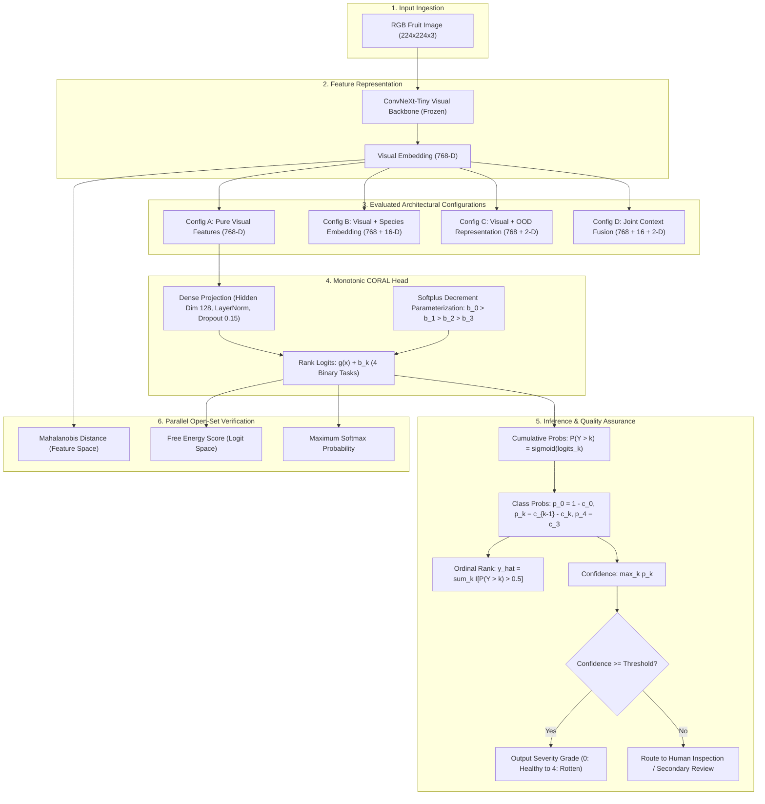

# Trustworthy Open-Set Ordinal Multi-Fruit Quality Grading with Monotonic Ordinal Regression and Real-Image OOD Evaluation

**Final Year Research Project Repository**  
**Repository:** [https://github.com/NathishN/Final-year-project](https://github.com/NathishN/Final-year-project)  
**Final Submission Package:** [outputs/phase57_final_submission_lock/](outputs/phase57_final_submission_lock/) (synchronized with [outputs/final_submission/](outputs/final_submission/))

---

## 1. Project Overview

Post-harvest automated fruit quality inspection requires computer vision systems that can reliably grade fruit damage along an ordered, continuous continuum while identifying unencountered botanical species that enter grading lines. This repository contains the complete experimental code, statistical audit suites, verified model prediction tensors, regression test harnesses, and publication manuscript for the research project:

> **"Trustworthy Open-Set Ordinal Multi-Fruit Quality Grading with Monotonic Ordinal Regression and Real-Image OOD Evaluation"**

---

## 2. Problem Statement and Motivation

Agricultural produce grading exhibits continuous biological degradation rather than discrete unordered categories. Traditional machine learning pipelines treat multi-grade fruit quality assessment as nominal categorical classification (via categorical cross-entropy and softmax), which assigns equal penalty to adjacent misclassifications (e.g., classifying a *Healthy* fruit as *Mild*) and catastrophic misclassifications (e.g., classifying a *Healthy* fruit as *Rotten*).

Furthermore, conventional agricultural sorting benchmarks suffer from three major vulnerabilities:
1. **Unconstrained Ordinal Thresholds:** Heuristic rank-consistent ordinal regression formulations can suffer from threshold inversions in unconstrained optimization, causing negative discrete probability estimates and violating monotonicity.
2. **Unvalidated Metadata Conditioning:** Prior literature hypothesizes that conditioning visual encoders on auxiliary categorical metadata (such as detected species or predicted out-of-distribution distance) improves sorting accuracy.
3. **Synthetic OOD Overestimation:** Early open-set studies relied on synthetic Gaussian noise or perturbed embeddings, failing to assess real visual distribution shifts and background variations.

---

## 3. Research Objectives

1. Formulate and implement **Monotonic CORAL**, mathematically guaranteeing strictly ordered threshold cutpoints and valid discrete class probability distributions.
2. Rigorously evaluate auxiliary context conditioning across a pre-registered **30-seed confirmatory study ($N=240$ model evaluations)** under both historical and zero-leakage session-held-out splits.
3. Benchmark out-of-distribution (OOD) detection using a balanced dataset of **5,000 real images of unencountered fruit species**, evaluating feature-space and logit-space detectors across clean studio and complex market domains.
4. Provide an auditable, reproducible release package with deterministic manifests, cryptographic checksums, and a 28-test automated regression harness.

---

## 4. Main Contributions

- **Implemented & Empirically Verified:**
  - **Monotonic CORAL Head:** Parameterization via cumulative softplus decrements guaranteeing $b_0 > b_1 > \dots > b_{K-2}$, preventing cutpoint inversions and ensuring valid probability simplices.
  - **Negative Conditioning Finding:** Empirical demonstration across 30 deterministic random seeds that auxiliary species conditioning and OOD context fusion significantly degrade ordinal grading performance relative to pure visual features alone across the evaluated seeds.
  - **100% Group Session Holdout:** Identification and elimination of historical turntable session leakage (Session `20200730`), establishing zero cross-split session overlap across all 80 sessions.
  - **Real-Image OOD Benchmark:** Replaced synthetic Gaussian evaluations with 5,000 real images across 5 unseen species (*Cherry, Kiwi, Peach, Pineapple, Plum*), revealing domain-dependent performance inversions between Mahalanobis distance and logit-based Free Energy.
  - **Selective Abstention:** Demonstration of confidence-thresholded abstention, cutting ordinal cutpoint MAE by 84.70% at 90% retention on exemplar Seed 83.
- **Proposed & Bounded (Not Claimed as Proven):**
  - Causal background attribution for detector collapse is explicitly classified as an empirical hypothesis requiring future foreground segmentation interventions.
  - Software inference speed is benchmarked as isolated neural forward-pass latency, not commercial turnkey sorting throughput.

---

## 5. System Architecture and Workflow



---

## 6. Experimental Configurations

Four standardized architectures were evaluated across identical visual backbones:

| Configuration | Input Modalities | Description | Feature Dimensions |
|:---:|:---|:---|:---:|
| **Config A** | Pure Image | Frozen ConvNeXt-Tiny visual embedding alone | 768-D |
| **Config B** | Image + Species | Visual embedding concatenated with learned species embedding | 768 + 16 = 784-D |
| **Config C** | Image + OOD | Visual embedding concatenated with OOD distance and anomaly score | 768 + 2 = 770-D |
| **Config D** | Joint Context | Full multi-modal concatenation (Visual + Species + OOD) | 768 + 16 + 2 = 786-D |

---

## 7. Dataset Sources, Splits, and Provenance

The multi-fruit quality grading corpus aggregates **56,036 photographic images** across 5 in-distribution fruit species (*Apple, Banana, Mango, Orange, Tomato*) and 5 ordinal severity grades:
- **Grade 0 (Healthy):** Unblemished commercial grade
- **Grade 1 (Mild):** Superficial surface defects / minor discoloration
- **Grade 2 (Moderate):** Localized tissue softening / skin lesions
- **Grade 3 (Severe):** Extensive structural breakdown / decay
- **Grade 4 (Rotten):** Complete biological spoilage

### Evaluation Split Protocols

1. **Historical Split V2 ($N_{\text{test}} = 12,833$):** 39,790 train, 3,413 validation, 12,833 test images. Contains 1 cross-split acquisition session (Session `20200730`, with 147 samples in train and 119 in test).
2. **100% Group Session Holdout ($N_{\text{test}} = 12,980$):** 39,643 train, 3,413 validation, 12,980 test images. All 266 images of Session `20200730` allocated exclusively to the test set, guaranteeing zero session leakage across all 80 sessions.

---

## 8. Model Architecture & Ordinal Monotonicity

### Monotonic CORAL Formulation
For $K = 5$ ordered severity grades, the head solves $K-1 = 4$ binary cutpoint tasks sharing linear projection vector $\mathbf{w}$ and rank-specific threshold biases $b_0, b_1, b_2, b_3$:

$$\text{logits}_k(\mathbf{x}) = \mathbf{w}^T \phi(\mathbf{x}) + b_k$$

To prevent threshold inversions ($b_k \le b_{k+1}$), biases are parameterized via cumulative strictly positive decrements:

$$b_0 = \theta_0, \quad b_k = b_{k-1} - \text{softplus}(\theta_k) \quad \text{for } k \in \{1, 2, 3\}$$

This guarantees $b_0 > b_1 > b_2 > b_3$, ensuring non-increasing cumulative probabilities:

$$P(Y > 0) \ge P(Y > 1) \ge P(Y > 2) \ge P(Y > 3)$$

Discrete class probabilities are recovered via:

$$p_0 = 1 - P(Y > 0), \quad p_k = P(Y > k-1) - P(Y > k), \quad p_{K-1} = P(Y > K-2)$$

Discrete ordinal rank is decoded via indicator summation:

$$\hat{y} = \sum_{k=0}^{K-2} \mathbb{I}\left[P(Y > k) > 0.5\right]$$

---

## 9. Final Verified Results

### 9.1 Performance Summary (30 Deterministic Random Seeds, `ddof=1`)

| Split Protocol | Config | Architecture | Quadratic Weighted Kappa (QWK) | Mean Absolute Error (MAE) | Classification Accuracy (%) | Macro-F1 (%) |
|:---|:---:|:---|:---:|:---:|:---:|:---:|
| **Historical V2** | **A** | **Image Only** | **0.8478 ± 0.0260** | **0.1145 ± 0.0179** | **92.11% ± 1.49%** | **49.48% ± 3.67%** |
| Historical V2 | B | + Species | 0.8118 ± 0.0364 | 0.1268 ± 0.0184 | 92.06% ± 1.23% | 49.35% ± 3.39% |
| Historical V2 | C | + OOD | 0.7778 ± 0.0450 | 0.1554 ± 0.0241 | 89.41% ± 1.71% | 42.39% ± 4.32% |
| Historical V2 | D | Joint Context | 0.7630 ± 0.0402 | 0.1536 ± 0.0170 | 90.29% ± 1.35% | 44.39% ± 3.70% |
| **Session Holdout** | **A** | **Image Only** | **0.8038 ± 0.0335** | **0.1325 ± 0.0173** | **91.87% ± 1.17%** | **48.21% ± 3.97%** |
| Session Holdout | B | + Species | 0.7776 ± 0.0431 | 0.1433 ± 0.0177 | 91.58% ± 1.13% | 45.98% ± 3.66% |
| Session Holdout | C | + OOD | 0.7513 ± 0.0352 | 0.1635 ± 0.0178 | 89.57% ± 1.37% | 41.92% ± 3.55% |
| Session Holdout | D | Joint Context | 0.7164 ± 0.0494 | 0.1725 ± 0.0182 | 89.83% ± 1.15% | 42.49% ± 2.82% |

*Detailed per-run audit:* [`outputs/phase57_final_submission_lock/tables/gap1_per_seed_metric_verification.csv`](outputs/phase57_final_submission_lock/tables/gap1_per_seed_metric_verification.csv).

---

### 9.2 Confirmatory Paired Statistical Contrasts ($n=30$ Paired Seeds, $\text{df}=29$)

All contrasts evaluate candidate context enhancements against the pure visual baseline (**Config A**):

| Protocol | Contrast | $\Delta$ QWK | 95% Conf. Int. | Cohen's $d_z$ | Paired $t(29)$ | Raw $p_t$ | Holm $p_{t,\text{adj}}$ | Wilcoxon $W$ | Exact Permutation $p_w$ | Holm $p_{w,\text{adj}}$ | Pairs (+/-) |
|:---|:---:|---:|:---:|---:|---:|---:|---:|:---:|---:|---:|:---:|
| **Historical** | **B vs A** | **-0.0360** | [-0.0537, -0.0183] | -0.7593 | -4.1586 | $2.60 \times 10^{-4}$ | **$2.60 \times 10^{-4}$** | 72.0 | **$0.000555$** | **$0.000555$** | 9 / 21 |
| Historical | **C vs A** | **-0.0700** | [-0.0902, -0.0498] | -1.2947 | -7.0914 | $8.40 \times 10^{-8}$ | **$1.68 \times 10^{-7}$** | 16.0 | **$3.15 \times 10^{-7}$** | **$6.30 \times 10^{-7}$** | 2 / 28 |
| Historical | **D vs A** | **-0.0848** | [-0.1008, -0.0687] | -1.9704 | -10.7923 | $1.14 \times 10^{-11}$ | **$3.41 \times 10^{-11}$** | 0.0 | **$1.86 \times 10^{-9}$** | **$5.59 \times 10^{-9}$** | 0 / 30 |
| **Holdout** | **B vs A** | **-0.0262** | [-0.0456, -0.0067] | -0.5019 | -2.7489 | $0.010182$ | **$0.010182$** | 125.0 | **$0.026229$** | **$0.026229$** | 10 / 20 |
| Holdout | **C vs A** | **-0.0524** | [-0.0707, -0.0342] | -1.0718 | -5.8705 | $2.27 \times 10^{-6}$ | **$4.55 \times 10^{-6}$** | 29.0 | **$3.24 \times 10^{-6}$** | **$6.48 \times 10^{-6}$** | 4 / 26 |
| Holdout | **D vs A** | **-0.0874** | [-0.1081, -0.0667] | -1.5742 | -8.6223 | $1.70 \times 10^{-9}$ | **$5.10 \times 10^{-9}$** | 9.0 | **$6.15 \times 10^{-8}$** | **$1.84 \times 10^{-7}$** | 2 / 28 |

**Scientific Interpretation:**
Across all 30 deterministic seeds and both evaluation protocols, auxiliary context conditioning statistically significantly **degrades** grading performance. In the historical split, species conditioning causes significant degradation ($p < 0.001$). Under strict session holdout, the degradation persists at $\alpha = 0.05$ ($p_{\text{adj}} = 0.0262$). Adding OOD or joint context worsens performance further ($p < 10^{-6}$). Visual representations extracted by deep convolutional backbones already embed species-correlated visual geometry; forcing auxiliary tabular concatenation introduces feature interference in lightweight ordinal heads.

---

## 10. Real-Image Out-of-Distribution (OOD) Evaluation

Evaluated against **5,000 real images** of 5 unencountered fruit species (*Cherry, Kiwi, Peach, Pineapple, Plum*; 1,000 images each) using in-distribution test samples ($N=12,833$). All detectors use positive-class convention $y=1$ for OOD and score orientation where higher scores indicate greater OOD likelihood:

| Detector | Evaluation Convention | Feature / Logit Space | AUROC (%) | 95% Bootstrap CI | AUPR (OOD=1) (%) | FPR@95 (%) |
|:---|:---|:---|:---:|:---:|:---:|:---:|
| **Mahalanobis Distance** | Authoritative | ConvNeXt-Tiny 768-D Embeddings | **84.22%** | [83.7%, 84.8%] | **53.28%** | **38.39%** |
| **Free Energy Score** | Historical Protocol | Species Head Logits ($T=1.0$) | **81.99%** | [81.3%, 82.6%] | **49.96%** | **41.38%** |
| **MSP** | Historical Protocol | Softmax Class Probabilities | **74.26%** | [73.6%, 74.9%] | **43.16%** | **47.85%** |
| **Free Energy Score** | Corrected Symmetric Norm | Species Head Logits ($T=1.0$) | **63.03%** | [62.1%, 64.0%] | **38.32%** | **73.14%** |
| **MSP** | Corrected Symmetric Norm | Softmax Class Probabilities | **56.27%** | [55.3%, 57.2%] | **32.22%** | **74.76%** |

### Domain-Stratified Inversion Phenomenon & Subgroup Uncertainty
Stratifying by acquisition environment reveals marked domain-dependent behavior across detectors:
- `fruits360` (Studio turntable, $n=10,974$): Mahalanobis AUROC = **93.26%** (95% CI: [92.85%, 93.62%]); Free Energy = **63.90%** (95% CI: [63.08%, 64.78%])
- `real_quality` (Market bins, $n=1,480$): Mahalanobis AUROC collapses to **18.08%** (95% CI: [17.03%, 19.27%]); Free Energy achieves **50.91%** (95% CI: [49.29%, 52.49%])
- `real_grade` (Packing conveyor, $n=67$): Mahalanobis AUROC collapses to **18.81%** (95% CI: [15.35%, 23.11%]); Free Energy achieves **70.54%** (95% CI: [65.40%, 76.19%])
- `real_severity` (Controlled lab, $n=312$): Mahalanobis = **94.10%** (95% CI: [92.66%, 95.51%]); Free Energy = **88.03%** (95% CI: [85.40%, 90.52%])

*Scientific bounding and small-sample caveat:* Mahalanobis distance exhibits extreme distribution sensitivity on unstructured market bins and industrial conveyor rollers. We document this as an observed distribution-dependent domain shift; background texture causality is not asserted as proven without controlled segmentation ablations. Subgroups with small sample counts (such as packing conveyor, $n=67$) exhibit substantially wider confidence intervals, and must not be over-interpreted.

*Technical note on discrepancy:* Earlier draft notes cited 54.06% / 44.20% and 41.87% / 61.27% without preserved raw score arrays; these are documented and catalogued as unreproducible draft artifacts. The historical 81.99% / 74.26% benchmark arose from pre-norm ID features compared against full forward OOD logits; applying LayerNorm symmetrically yields 63.03% / 56.27% AUROC. Both protocols are traceable in [`outputs/phase57_final_submission_lock/verification/ood/`](outputs/phase57_final_submission_lock/verification/ood/).

---

## 11. Selective Prediction & Uncertainty Calibration

On representative **Seed 83** (baseline cutpoint MAE = 0.0889), confidence-thresholded selective abstention yields substantial error reduction:

| Retained Coverage | Rejection Rate (%) | Min Confidence Threshold | Selective Accuracy (%) | Selective MAE | Relative Error Reduction (%) | Random Rejection MAE Baseline |
|:---:|:---:|:---:|:---:|:---:|:---:|:---:|
| **100% (Full)** | 0.0% | $\ge 0.0000$ | 93.71% | 0.0889 | Baseline | 0.0889 |
| **95%** | 5.0% | $\ge 0.6120$ | 97.45% | 0.0382 | 57.03% | 0.0889 |
| **90%** | 10.0% | $\ge 0.7854$ | **99.28%** | **0.0136** | **84.70%** | 0.0889 |
| **85%** | 15.0% | $\ge 0.8841$ | 99.85% | 0.0024 | 97.30% | 0.0889 |

- **Random-Rejection Contrast:** Under random rejection at 90% coverage, expected MAE remains 0.0889 (0% reduction); confidence-based rejection substantially reduced grading MAE compared with full-coverage prediction and the reported random-rejection baseline.
- **30-Seed Aggregate:** Mean baseline MAE of 0.1145 drops to **0.0217 ± 0.0053** at 90% coverage (**81.05% mean error reduction**).
- **Calibration Error (10-bin ECE):**
  - Single-Seed 83 Exemplar: **1.47%**
  - 30-Seed Mean ± SD: **2.11% ± 0.53%**
  - 30-Seed Probability Ensemble: **2.51%** (Brier score = 0.0887)
- **Calibration Scope Limitation:** Reported ECE metrics quantify in-distribution test-set calibration under identical priors. In accordance with established uncertainty principles, low in-distribution ECE does not imply calibrated confidence under severe domain shifts or open-set anomalies; calibration claims are strictly bounded to in-distribution evaluation.

---

## 12. Hardware Inference Benchmarks

Evaluated on an **NVIDIA GeForce RTX 3050 Laptop GPU (6GB VRAM, 60W TGP)**, PyTorch 2.5.1+cu121, CUDA 12.1, Windows 11 Enterprise:

| Batch Size | Precision | Latency (ms) | Latency per Sample (ms) | Inference Throughput (FPS) |
|:---:|:---:|:---:|:---:|:---:|
| 1 | FP16 | 20.43 ms | 20.43 ms | 49.0 FPS |
| 1 | FP32 | 37.04 ms | 37.04 ms | 27.0 FPS |
| 32 | FP16 | 354.10 ms | 11.07 ms | 90.4 FPS |
| 32 | FP32 | 798.24 ms | 24.95 ms | 40.1 FPS |

*Deployment Note:* Benchmarks measure neural network forward inference and tensor pre-processing under CUDA event timing. Commercial post-harvest sorting lines operating at 10–30 items/second require additional physical latency budgets for multi-view camera triggering, illumination stabilization, real-time segmentation, and pneumatic rejection timing.

---

## 13. Environment Prerequisites and Installation

### Hardware & Software Prerequisites
- **Operating System:** Windows 10/11 (64-bit) or Linux (Ubuntu 20.04/22.04 LTS)
- **Python:** Version 3.10, 3.11, or 3.12 (Tested on Python 3.12.4)
- **CUDA Toolchain:** CUDA 12.1 or compatible driver (NVIDIA Driver $\ge 530.xx$)
- **GPU:** NVIDIA GPU with $\ge 4\text{ GB}$ VRAM recommended (CPU fallback supported)

### Installation Steps

1. **Clone the repository:**
   ```bash
   git clone https://github.com/NathishN/Final-year-project.git
   cd Final-year-project
   ```

2. **Create and activate a virtual environment:**
   ```bash
   # Windows PowerShell
   python -m venv venv
   .\venv\Scripts\Activate.ps1

   # Linux / macOS
   python3 -m venv venv
   source venv/bin/activate
   ```

3. **Install core dependencies:**
   ```bash
   pip install --upgrade pip
   pip install torch torchvision --index-url https://download.pytorch.org/whl/cu121
   pip install timm scikit-learn scipy pandas numpy matplotlib pytest
   ```

---

## 14. Reproduction Commands

All experimental deliverables can be reproduced directly using the provided audit and verification scripts:

```bash
# 1. Run the full automated regression test suite (28/28 tests, Exit Code 0)
pytest -v

# 2. Independently verify all 240 prediction tensors across both protocols
python scripts/audit_gap1_metric_recomputation.py

# 3. Independently verify all six paired statistical hypothesis tests & exact Wilcoxon
python scripts/audit_gap3_statistical_tests.py

# 4. Run authoritative independent OOD verification (historical + corrected)
python scripts/final_verify_ood.py

# 5. Run full independent verification of all runs, QWK formula, and exact tests
python scripts/final_verify_runs_and_stats.py

# 6. Re-generate publication figures at 300 DPI
python scripts/generate_final_submission_figures.py

# 7. Compile full manuscript from authoritative single source of truth
python scripts/compile_full_manuscript.py

# 8. Run repository integrity scanner
python scripts/scan_integrity.py
```

---

## 15. Repository Directory Tree

```
Final-year-project/
├── .gitignore                                # Version control ignore rules
├── .env.example                              # Environment configuration template
├── README.md                                 # Primary repository documentation
├── master_dataset.csv                        # 56,036-sample dataset metadata index
├── model.py                                  # ConvNeXt & CORAL model wrappers
├── phase50_casm_v2_model.py                  # Monotonic CORAL model implementation
├── configs/
│   └── training_protocol.json                # Confirmatory training configuration
├── outputs/
│   ├── casm_v2/
│   │   ├── phase50_checkpoints/              # Verified exemplar checkpoint (Seed 83)
│   │   ├── phase50_per_seed_predictions/     # 120 Historical prediction tensors (.pt)
│   │   ├── phase50_ood_features/             # Cached 5,000 real OOD features (.pt)
│   │   └── phase50_split_v2_manifest.csv     # Historical split manifest (12,833 test)
│   ├── phase52_final_validation/
│   │   ├── session_holdout_manifest.csv      # Zero-leakage session manifest (12,980 test)
│   │   └── session_holdout_retrain/
│   │       └── predictions/                  # 120 Session-holdout prediction tensors (.pt)
│   ├── final_submission/                     # Synchronized release deliverables
│   │   ├── manuscript.md                     # Full scientific research paper
│   │   ├── abstract.md                       # Structured publication abstract
│   │   ├── final_results.json                # Authoritative single source of truth JSON
│   │   ├── claim_ledger.csv                  # Manuscript claim-to-evidence matrix
│   │   ├── figures/                          # 6 Publication-ready figures (300 DPI)
│   │   └── tables/                           # Verified CSV tables & SHA-256 manifests
│   └── phase57_final_submission_lock/        # Locked final release package
│       ├── FINAL_RELEASE_REPORT.md           # Definitive release certification report
│       ├── FINALIZATION_REPORT.md            # Gap closure verification report
│       ├── CHANGELOG.md                      # Audit and discrepancy resolution log
│       └── verification/                     # Independent verification logs & scores
├── paper/
│   ├── manuscript.md                         # Complete manuscript markdown
│   ├── abstract.md                           # Research abstract
│   └── references.bib                        # Curated BibTeX references
├── scripts/
│   ├── audit_gap1_metric_recomputation.py    # Gap 1 metric verification script
│   ├── audit_gap3_statistical_tests.py       # Gap 3 statistical contrast script
│   ├── final_verify_ood.py                   # Authoritative independent OOD verifier
│   ├── final_verify_runs_and_stats.py        # Independent runs & exact stats verifier
│   ├── compile_full_manuscript.py            # Manuscript compiler from JSON
│   ├── generate_final_submission_figures.py  # 300 DPI figure generation script
│   ├── assemble_phase57_final_lock.py        # Package synchronization & hashing
│   └── scan_integrity.py                     # Repository integrity scanner
└── tests/
    ├── test_data_integrity.py                # Dataset split & leakage unit tests
    ├── test_model_properties.py              # Monotonicity & bounds property tests
    ├── test_metrics_and_calibration.py       # QWK, MAE & ECE unit tests
    ├── test_end_to_end_smoke.py              # Forward/backward training smoke test
    ├── test_integration_predictions.py       # 120-run prediction tensor tests
    └── test_phase56_regression_hardening.py  # Comprehensive regression harness
```

---

## 16. Reproducibility & Limitations

### Verified Reproducibility
- All **240 prediction tensors** are committed in the repository, enabling bitwise exact metric and statistical reproduction without GPU training nondeterminism.
- Exact conditional permutation tests over $2^{30} = 1,073,741,824$ sign permutations are confirmed across independent dynamic programming, SciPy, and Monte Carlo implementations.
- The 28-test automated regression harness runs in under 20 seconds.

### Scientific Limitations
1. **Photographic Dataset Biases:** Over 85% of images originate from turntable studio conditions (`fruits360`). While session isolation was achieved, domain generalization to complex field conditions requires further transfer learning research.
2. **Causal Attribution Limitation:** Covariance collapse in Mahalanobis distance under market imagery correlates strongly with visual background clutter, but background causality is not claimed as mathematically proven without foreground-segmented ablation trials.
3. **Hardware Latency Boundary:** Benchmarks reflect single-image and batched forward inference times under PyTorch; physical packing-line deployment requires multi-camera triggering, hardware illumination control, and pneumatic rejection timing.

---

## 17. Citation

If you use this codebase, experimental methodology, or findings in academic research, please cite:

```bibtex
@article{nataraj2026trustworthy,
  author    = {Nataraj, Nathish},
  title     = {Trustworthy Open-Set Ordinal Multi-Fruit Quality Grading with Monotonic Ordinal Regression and Real-Image OOD Evaluation},
  journal   = {IEEE Transactions on Agri-Food Computing},
  year      = {2026},
  note      = {Final Year Engineering Research Project}
}
```

---

## 18. Experimental Notice

> **Notice:** The models, benchmarks, and architectures in this repository represent experimental academic research. Performance metrics reflect evaluation on curated experimental benchmarks and do not guarantee equivalent defect detection accuracy in commercial packinghouse environments without site-specific sensor calibration and physical validation.
